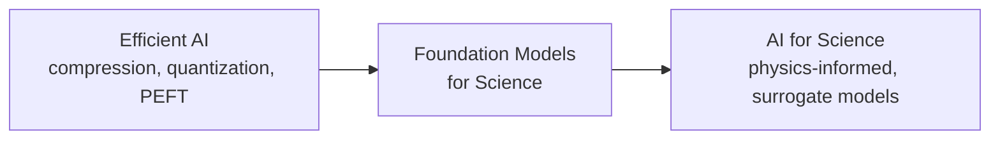

<!-- Header banner -->
<p align="center">
  
</p>

<p align="center">
  <a href="https://git.io/typing-svg">
    
  </a>
</p>

<p align="center">
  <a href="https://hamadbijarani.github.io"></a>
  <a href="https://scholar.google.com/citations?user=tfdjEF0AAAAJ&hl=en"></a>
  <a href="https://orcid.org/0009-0007-9151-6633"></a>
  <a href="https://huggingface.co/hamadbijarani012"></a>
  <a href="https://www.linkedin.com/in/hamadullah-bijarani/"></a>
  <a href="mailto:hamadullahkhanbijarani@gmail.com"></a>
  <a href="https://x.com/hamadbijarani01"></a>
</p>

---

## 👋 About me

I'm a Computer Systems Engineering undergraduate at **Sukkur IBA University** (graduating May 2027). I'm an AI researcher focused on AI for science, from physics-informed learning and surrogate modeling to foundation models for scientific reasoning. I also work on efficient AI, including model compression, quantization and parameter-efficient adaptation, and I like turning research into tools that actually run.

I also build **workflow automations** with n8n and Make.com, including AI agents that talk to customers over WhatsApp and keep their data in Google Sheets.

### At a glance

| | |
|---|---|
| 🎓 **Education** | B.E. Computer Systems Engineering, Sukkur IBA University (CGPA 3.48 / 4.00) |
| 🏅 **Honors** | Sukkur IBA STHP Merit Scholarship · PSF Science Talent Farming Scheme (STFS) National Scholarship |
| 🧩 **Applied work** | 50+ AI and automation projects delivered for clients (RAG, LLM apps, tool-calling agents) |
| 💼 **Experience** | Data Analyst Intern at KPMG Australia (remote, 2025) · Team Lead, PEC Generative AI Hackathon |
| 🤝 **Status** | Open to research collaboration |

## 🔬 Research interests

<table>
  <tr>
    <td width="33%" valign="top">
      <h3>🌍 AI for Science</h3>
      <p>Machine learning that supports discovery and models complex physical systems.</p>
      <sub>Scientific ML · physics-informed learning · surrogate modeling</sub>
    </td>
    <td width="33%" valign="top">
      <h3>🧬 Foundation Models for Science</h3>
      <p>Pretrained models that reason over heterogeneous scientific data.</p>
      <sub>Multimodal learning · scientific reasoning</sub>
    </td>
    <td width="33%" valign="top">
      <h3>⚡ Efficient AI</h3>
      <p>Compact models and efficient inference that keep the representations that matter.</p>
      <sub>Distillation · pruning · 4-bit and 8-bit quantization · LoRA/DoRA</sub>
    </td>
  </tr>
</table>



<details>
<summary><b>🧪 A small taste of my work: simulating weight quantization</b></summary>

<br/>

Fewer bits means less memory but coarser steps, and a few outlier weights stretch the range so everything else gets fewer useful levels. Here is the core idea in a few lines:

```python
import torch

def fake_quantize(w: torch.Tensor, bits: int = 4) -> torch.Tensor:
    """Symmetric per-tensor quantization, returned in float for error analysis."""
    qmax = 2 ** (bits - 1) - 1
    scale = w.abs().max() / qmax
    return torch.clamp((w / scale).round(), -qmax - 1, qmax) * scale

w = torch.randn(64)
print(f"INT4 MSE: {((w - fake_quantize(w, 4)) ** 2).mean():.5f}")
```

You can play with an interactive version, plus a LoRA parameter and memory calculator, on my [portfolio](https://hamadbijarani.github.io).

</details>

## 📄 Publication

> **[Energy-Efficient NLP Through Tiny-Model Distillation, Pruning, and Quantized Inference](https://kjmr.ac.pk/kjmr/article/view/965)**
> Hamadullah Bijarani · *Kashf Journal of Multidisciplinary Research (KJMR)*, 2026
>
> **Key finding:** on BERT and TinyBERT, a distilled student was the most energy-efficient variant, while quantization and pruning shrank model size but added GPU kernel overhead. Combining INT8 quantization with aggressive pruning raised energy use by up to 4× compared to the standard student, so smaller on paper does not always mean cheaper on hardware.

## 🚀 Featured projects

<table>
  <tr>
    <td width="50%" valign="top">
      <h3>📄 Multi-Document RAG Chatbot</h3>
      <p>Document-grounded question answering across multiple PDFs: parsing, chunking, embeddings, vector search and generation.</p>
      <p>  </p>
      <a href="https://github.com/hamadbijarani/Multiple-PDF-RAG-Chatbot">View repository →</a>
    </td>
    <td width="50%" valign="top">
      <h3>🧑‍🏫 Adaptive AI Study Coach</h3>
      <p>Semantic memory, conversational Q&A, quizzes and flashcards. Built as team lead at the PEC Generative AI Hackathon.</p>
      <p>  </p>
      <a href="https://github.com/hamadbijarani/AI-Study-Coach">View repository →</a>
    </td>
  </tr>
  <tr>
    <td width="50%" valign="top">
      <h3>💬 High-Throughput Sentiment Classifier</h3>
      <p>Sentiment classification over 100,000+ customer reviews using pretrained embeddings and a BiLSTM with self-attention.</p>
      <p>  </p>
      <a href="https://github.com/hamadbijarani/Sentiment-Analysis-using-LSTM">View repository →</a>
    </td>
    <td width="50%" valign="top">
      <h3>🖥️ DSD8 Processor</h3>
      <p>Semester 7 digital system design project, with a full write-up of the design details and results.</p>
      <p> </p>
      <a href="https://hamadbijarani.github.io/projects/sem-7/dsd8-processor.html">Read the project page →</a>
    </td>
  </tr>
</table>

## 🛠 Tech stack

<p>
  
</p>
<p>
  
  
  
  
  
</p>


## 📊 GitHub stats

<p align="center">
  
  
</p>

## 🤝 Let's connect

I'm open to research collaboration, internships and automation projects. The quickest way to reach me is by [email](mailto:hamadullahkhanbijarani@gmail.com) or on [LinkedIn](https://www.linkedin.com/in/hamadullah-bijarani/). My full CV is on my [portfolio](https://hamadbijarani.github.io).

<p align="center">
  
</p>
